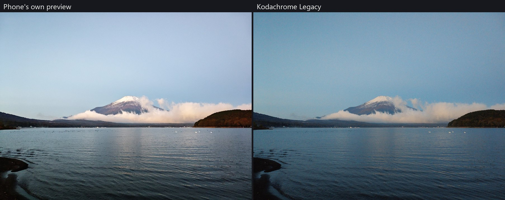
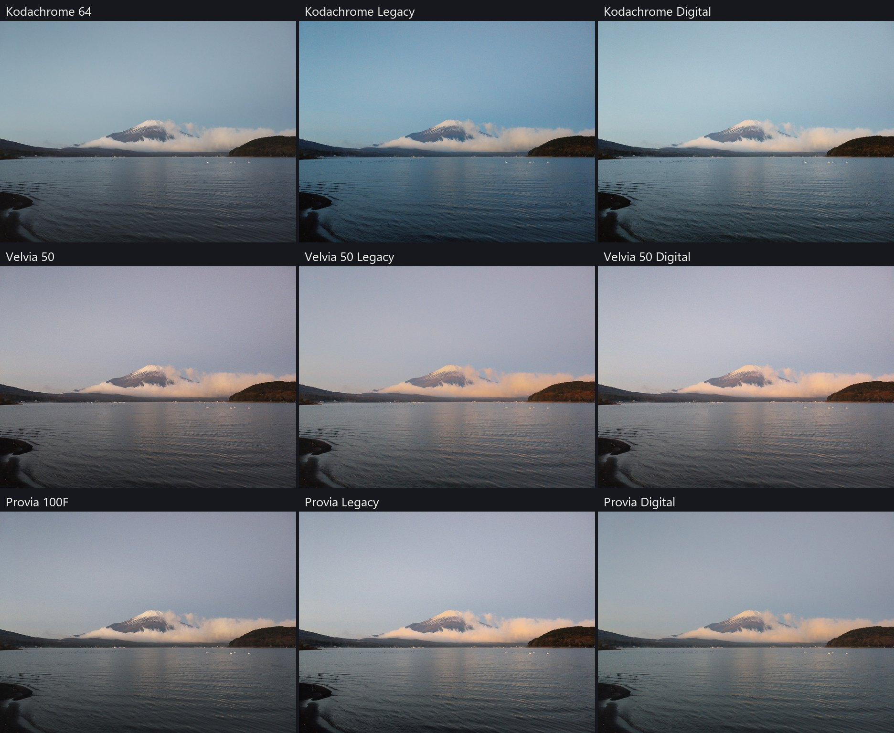
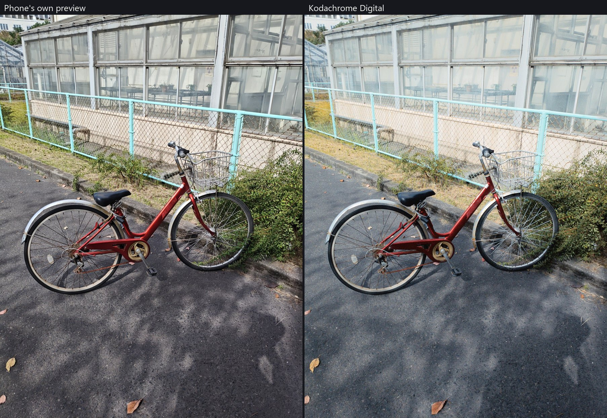
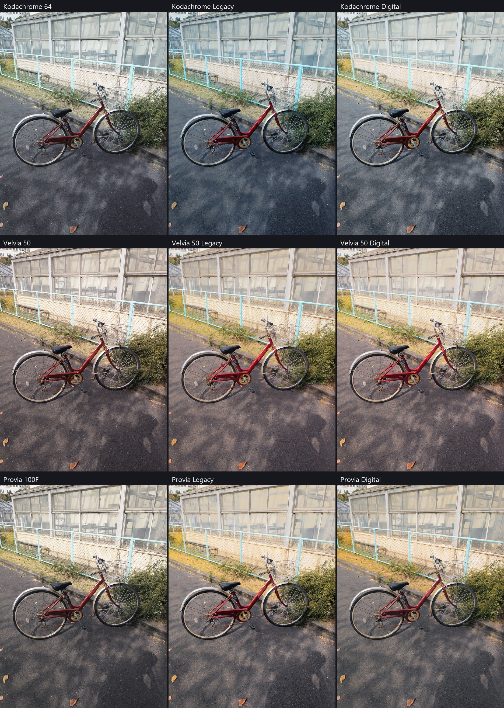
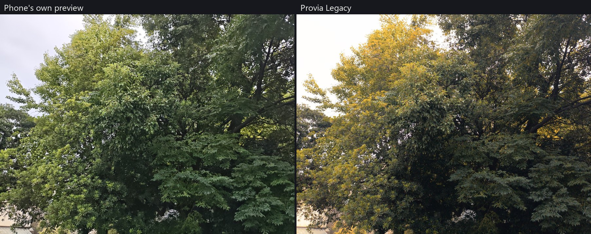
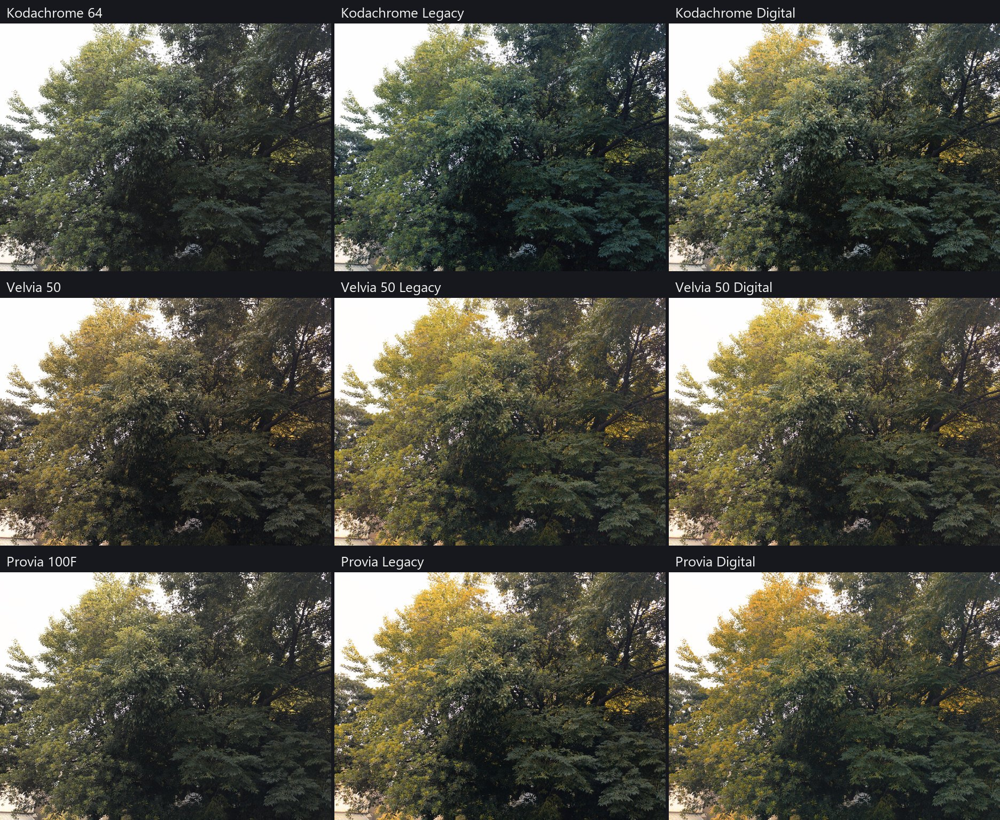

**Version 0.5, by Huynh Ton Phuc.** A desktop colour app built with phone photographers in mind: shoot raw on your phone, open the DNG, choose a film. **FilmForge**, the first module, turns that file into the look of colour slide film by simulating the film rather than applying a preset. Camera raw works too.



*One Redmi Turbo 4 Pro raw file. Left: the phone's own preview. Right: the Kodachrome Legacy card with exposure +0.7 EV and saturation -15.*

This is a personal, for-fun research project: source-available for **non-commercial use** under the [PolyForm Noncommercial License 1.0.0](LICENSE). It is not open source in the OSI sense, it is not a product, and there is no warranty or support promise.

## Built with phone photographers in mind

Phone raw is the starting point here, not an afterthought:

- **Noise is handled where it starts.** Small sensors are noisy, so raw is denoised on the sensor mosaic, using a noise model read from the photo itself.
- **The phone's own blur is removed before the film.** Film sharpness then acts on the scene rather than on the lens's softness. This measured profile exists only for the Redmi Turbo 4 Pro, the phone it was developed on; other phones' raw files open and go through the film, without this step.
- **Film effects are set in real sizes.** Scatter, edge effects and grain are set in micrometres on a film frame, not in pixels, so a phone photo keeps its own resolution and gets the same film structure as any other.
- **No gaming PC needed.** It was developed on a laptop with Intel Iris Xe graphics and no NVIDIA card. There, a 12.5 MP phone raw took about 7 to 21 seconds per card at full resolution.

## Gallery

Photos by Huynh Ton Phuc, shot as raw on a Redmi Turbo 4 Pro. Every card uses the same two slider changes, exposure +0.7 EV and saturation -15, and nothing is retouched. Images are reduced to fit this page, so fine grain is hard to see.

### Mountain at dawn



### Bicycle





### Tree





## How it differs from presets and LUTs

Most film looks are a colour table or a stack of slider settings applied to a finished image. ColorForge instead follows the path light takes through film:

- **It starts from the sensor, not a finished image.** Bayer raw is read as its mosaic and denoised there, using a noise model taken from the photo itself, then brought into one working space: scene-linear BT.2020, D65, 32-bit float. Values outside 0-1 are kept.
- **Colour comes from dyes.** Scene light is projected onto each film's three layers, each layer's exposure sets a dye amount through the data-sheet curve, and the dyes filter the viewing light spectrally. Colour is an outcome of that chain rather than a target.
- **Spatial effects are physical sizes.** Light scatter, edge effects between layers and grain are set in micrometres on the film frame, so they don't depend on pixel count. Output resolution always equals input resolution.
- **Sharpness is non-linear, like chemistry.** Edge effects depend on local density, and each film's model is fitted to the MTF its maker printed.
- **Grain follows the dye.** Grain is calibrated to the film's printed RMS granularity and is applied in dye amount, per layer, not added over the finished picture.
- **Film and look are separate.** Film data stays as measured. "Legacy" and "Digital" cards add a bounded grade on top, labelled as a look, not as film.
- **Input is routed by what the file is.** Bit depth, stacked versus single frame, and phone versus camera decide what happens; well-exposed high-bit files aren't "enhanced" just because they can be.
- **AI repairs, it does not colour.** AI models only contribute fine detail after a frequency split, so broad tone and colour stay with the physics. Any AI micro-contrast in an export also saves a mask of what changed.
- **It runs on modest hardware.** Developed and tested on an Intel Iris Xe laptop: vendor-neutral GPU display through WebGPU/Vulkan, AI through OpenVINO.

## The film cards

| Group | Cards |
|---|---|
| K-14, from maker data | Kodachrome 25, 64, 200 |
| E-6, from maker data | Velvia 50, Velvia 100F, Provia 100F, Astia 100F, Ektachrome E100, E100G, E100VS, EPN, 100D |
| Film plus fitted look | Kodachrome, Velvia 50 and Provia, each as Legacy and Digital |

Each card has its own curves, dyes, sensitivity, sharpness, grain and starting sliders. Also included: lens correction for camera raw, camera-sharpness and grain controls, Calibrate sliders, and a Painting oil effect. Export to HDR JPEG, JPEG, JPEG XL or linear DNG.

## How it was calibrated

Film data comes from manufacturers' published technical data sheets, read from the drawing paths where possible. Dye data was checked against published spectral measurements of developed film. The looks were recalibrated and fused from statistics of many publicly shared pictures and scans; they were measured only, and no third-party images are in this repository. Numbers in stock files carry a provenance label: `datasheet` or `assumption`.

**Known issues, to be improved in the next update.** Velvia cards push greens too far toward yellow, because of how their grey balance is calibrated; other E-6 cards share the same cause to a lesser degree. Default exposure also runs dark, especially on backlit scenes.

**Be sceptical of the realism claim.** Interimage is not published by any maker and is an assumption, thickness and coupler structure in E-6 are only captured indirectly, the looks rest on small hand-picked sets, and no card has been checked against a real slide viewed next to the screen. Treat every card as an interpretation.

## Run it

Windows, Python 3.12:

```
env\setup.bat
env\run_colorforge.bat
```

The app opens in a local window at http://127.0.0.1:8765. Nothing is uploaded. Raw sample files are not included, so open your own. Tests: `env\cf\python.exe -m pytest tests -q`. Some tests skip because research files and sample photos aren't published.

## AI models

- **PMRID**, raw denoising. Wang, Y., Huang, H., Xu, Q., Liu, J., Liu, Y., Wang, J. *Practical Deep Raw Image Denoising on Mobile Devices.* ECCV 2020. Weights by Megvii Research, Apache-2.0. https://github.com/megvii-research/PMRID
- **Real-ESRGAN** (`realesr-general-x4v3`), optional micro-contrast. Wang, X., Xie, L., Dong, C., Shan, Y. *Real-ESRGAN: Training Real-World Blind Super-Resolution with Pure Synthetic Data.* ICCV Workshops 2021. BSD-3-Clause. https://github.com/xinntao/Real-ESRGAN

Both architectures are re-implemented here and only the weights are loaded.

## Built with

PyTorch, OpenVINO, NumPy, SciPy, OpenCV, Numba, colour-science, rawpy (LibRaw), lensfunpy (Lensfun), wgpu-py, Pillow, imagecodecs, tifffile and ExifRead. Three film cards use curves digitised by spectral_film_lut. See [NOTICE.md](NOTICE.md) for licences and all third-party credits.

## Licence

ColorForge's code, calibration and look data are under the [PolyForm Noncommercial License 1.0.0](LICENSE): free for personal, research and other non-commercial use, and commercial use is not licensed. For anything commercial, ask first. The author keeps the right to offer other licences later. The logo and gallery photos are by Huynh Ton Phuc, under the same licence. Third-party parts keep their own licences.

Film names are trademarks of their owners and are used only to describe which film is simulated. This project isn't affiliated with or endorsed by any film maker or photographer.
